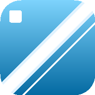
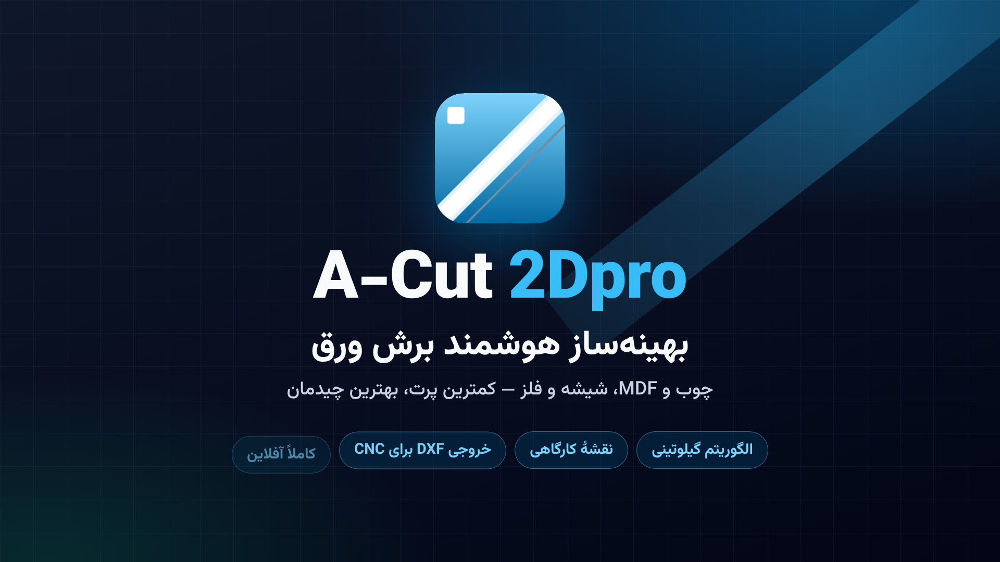

<div dir="rtl" align="right">

<div align="center">



# 🪚 A-Cut 2Dpro

### ورق را کامل ببر، پرت را به حداقل برسان.

**بهینه‌ساز هوشمند برش دوبعدی ورق** برای کارگاه‌های چوب، MDF، شیشه و فلز —
از ورود قطعات تا نقشهٔ برش، لیست قطعات، لیبل کارگاهی و فایل DXF؛ همه در مرورگر،
بدون نصب و حتی **آفلاین**.

<br />

[](https://gase99.github.io/Webxplusx/)
[](https://github.com/gase99/Webxplusx/actions/workflows/build-android.yml)
[](https://github.com/gase99/Webxplusx/actions/workflows/windows-exe.yml)

<br />

<!-- نشان‌های تکنولوژی -->
<p dir="ltr">
  
  
  
  
  
  
  
  
  
</p>

<!-- وضعیت خودکار مخزن -->
<p dir="ltr">
  <a href="https://github.com/gase99/Webxplusx/actions/workflows/deploy.yml"></a>
  <a href="https://github.com/gase99/Webxplusx/actions/workflows/build-android.yml"></a>
  <a href="https://github.com/gase99/Webxplusx/actions/workflows/windows-exe.yml"></a>
</p>

</div>

---

## 📖 معرفی 

**A-Cut 2Dpro** یک برنامهٔ وب کاملاً فارسی و راست‌چین است که قطعات یک پروژه را
می‌گیرد و آن‌ها را با کمترین پرت روی ورق‌های خام می‌چیند. خروجی فقط یک عدد و درصد
نیست؛ نقشهٔ برش قابل‌اجرا در کارگاه، لیست قطعات، لیبل چسباندنی و فایل DXF برای CNC
هم آماده می‌شود.

### 🎬 ویدیوی معرفی

[](promo-video/A-Cut-2Dpro-promo-voiced.mp4)

ویدیوی معرفی نرم‌افزار (۱۹۲۰×۱۰۸۰) در دو نسخه آماده است: **نسخهٔ صدادار با گویندگی
فارسی** (حدود ۵۳ ثانیه — با کلیک روی پوستر) و نسخهٔ خاموش ۴۰ ثانیه‌ای
([`A-Cut-2Dpro-promo.mp4`](promo-video/A-Cut-2Dpro-promo.mp4)).
کد ساخت ویدیو با Remotion، فایل‌های صدا، متن گویندگی و زیرنویس فارسی در پوشهٔ
[`promo-video`](promo-video/README.md) است — با یک دستور دوباره رندر می‌شود.

### 🪚 چرا الگوریتم گیلوتینی؟

در کارگاه واقعی، ارهٔ پانل‌بُر فقط **برش مستقیم از یک لبه تا لبهٔ مقابل** می‌زند؛
چیدمانی که خط برش شکسته یا متقاطع داشته باشد، روی دستگاه قابل اجرا نیست. موتور
A-Cut 2Dpro دقیقاً بر همین پایه نوشته شده است — **Guillotine Bin Packing**:

- فضای آزاد هر ورق به‌صورت مجموعه‌ای از مستطیل‌ها نگه داشته می‌شود و هر جای‌گذاری
  با یک برش سرتاسری، فضای باقی‌مانده را به دو مستطیل کوچک‌تر تقسیم می‌کند.
- قطعات **بزرگ‌تر اول** چیده می‌شوند (مرتب‌سازی نزولی مساحت) و برای هر قطعه
  بهترین فضای آزاد با معیار **Best Area Fit** و در تساوی **Best Short Side Fit**
  انتخاب می‌شود؛ در صورت مجاز بودن، چرخش ۹۰ درجه هم بررسی می‌شود.
- مستطیل‌های آزاد مجاور با هم ادغام می‌شوند تا تکه‌های بزرگ و پیوسته برای قطعات
  بعدی باقی بماند.

### 📐 محاسبهٔ ضخامت تیغه (Kerf)

هر برش، خودش مواد مصرف می‌کند. اگر تیغهٔ ۴ میلی‌متری را نادیده بگیرید، قطعات روی
کاغذ جا می‌شوند ولی روی ورق **به هم می‌چسبند**. A-Cut 2Dpro خوراک تیغه را از سمت
فضای باقی‌مانده (پرت) کم می‌کند، نه از ابعاد قطعه:

- ابعاد نهایی هر قطعه دقیقاً همان چیزی است که وارد کرده‌اید.
- بین هر دو قطعهٔ مجاور، حداقل به اندازهٔ ضخامت تیغه فاصله می‌ماند.
- اگر قطعه به لبهٔ ورق بچسبد، Kerf اضافه‌ای برای آن سمت حساب نمی‌شود.
- درصد پرت و بهره‌وری **با احتساب خوراک تیغه** گزارش می‌شود؛ عددی که با واقعیت
  کارگاه می‌خواند.

> [!TIP]
> نتیجه: ورق کمتر، پرت کمتر و نقشه‌ای که اپراتور بدون سؤال «این خط را از کجا ببرم؟»
> اجرا می‌کند. الگوریتم هیوریستیک است (مثل همهٔ موتورهای Nesting تجاری)؛ سریع،
> عملی و نزدیک به بهینه — نه ادعای بهینگی ریاضی مطلق.

---

## ✨ امکانات کلیدی 

### ۱) 📐 ورود هوشمند؛ برش ۴۵° (فارسی)، شیار و نوار لبه‌چسب (PVC)

- جدول ورود اطلاعات دو سطحی و کاملاً فارسی با ستون‌های **نوار**، **فارسی** و **شیار**؛
  هر عملیات برای لبه‌های موازی طول و عرض جداگانه تنظیم می‌شود
  (`۰` بدون عملیات، `۱` یک لبه، `۲` هر دو لبهٔ مقابل).
- جریان ورود سریع با کیبورد: `نام ← طول ← عرض ← تعداد ← Enter` و ردیف جدید
  خودکار درست زیر همان ردیف ساخته می‌شود؛ ارقام فارسی/عربی (`۱۲۳…`) هم پذیرفته
  می‌شوند.
- محاسبهٔ لحظه‌ای متراژ نوار PVC، طول برش فارسی ۴۵° و متراژ شیار ورق ۳ میلی‌متری.

### ۲) 🖨️ چاپ کارگاهی A4 (صفحه‌بندی تفکیک‌شده)

- یک دکمه: **«چاپ نقشه و لیست قطعات»** — سند چاپی صفحه‌بندی «تفکیک‌شده» دارد:
  نقشهٔ هر ورق خام روی یک برگهٔ کامل A4 (بزرگ و تمام‌عرض، بدون فشرده‌سازی)
  چاپ می‌شود و جدول گروه‌بندی‌شدهٔ قطعات + **فاکتور متریال** (نوار، فارسی،
  شیار) در برگه‌های جدا در انتها می‌آیند تا همهٔ نوشته‌ها درشت و خوانا بمانند.
- خروجی سیاه‌وسفید و بهینه‌شده برای چاپ کارگاهی؛ برای PDF کافی است در دیالوگ چاپ
  مرورگر «Save as PDF» را انتخاب کنید.
- 📱 **روی گوشی، نسخهٔ APK و PWA نصب‌شده** که چاپ مستقیم (`window.print`)
  پشتیبانی نمی‌شود، همین دکمه‌ها به‌صورت خودکار **«دانلود PDF»** می‌شوند:
  فایل PDF ‏(A4، با وضوح بالا) از همان سند ساخته و دانلود/اشتراک‌گذاری
  می‌شود تا آن را ذخیره یا چاپ کنید (`src/exportPdf.ts`).
- برگهٔ کنترل تولید با مربع تیک برای کنترل کیفیت، و **لیبل قطعات** در شبکهٔ
  ۳×۵ روی A4 (کد قطعه، ابعاد، ورق، مختصات و علائم عملیات).

### ۳) 🪚 نقشهٔ سیاه‌وسفید با علائم استاندارد زیر ابعاد (سبک CAD نقشه‌کشی)

- نقشه با SVG و در واحد میلی‌متر رندر می‌شود؛ در هر بزرگ‌نمایی شارپ است و
  با زوم ۵۰٪ تا ۳۰۰٪ بررسی می‌شود.
- بدنهٔ قطعات سفید با حاشیهٔ مشکی، پرت با هاشور خاکستری/مشکی — همان استاندارد
  نقشهٔ کارگاهی. هیچ نوشته‌ای بیرون قطعه نیست: نام و ابعاد («طول: …/عرض: …»)
  درشت و مشکی در مرکز هر قطعه نوشته می‌شود (در قطعات چرخیده، کل بلوک ۹۰° می‌چرخد).
- عملیات لبه‌ها با «علامت» دقیقاً زیر عدد همان جهت نشان داده می‌شود و بالای
  نقشه کادر «راهنمای علائم» هست: **خط ممتد = نوار، خط‌چین = شیار، حرف «ف» کنار
  عدد = برش فارسی ۴۵°**؛ برای دو لبه علامت دوتایی می‌شود (دو خط / «ف ف») و اگر
  جهتی هم نوار داشته باشد هم شیار، خط‌ها زیر هم می‌آیند. در قطعات خیلی باریک
  (زیر ۴۰mm) فقط ابعاد فشرده («۱۲۰۰×۳۰») می‌آید.
- برچسب هر قطعه: نام، ابعاد نهایی، شمارهٔ ورق و نمونه — دقیقاً هم‌کد با لیبل و DXF
  (`S1-03`).

### ۴) 🗄️ دیتابیس محلی (IndexedDB)

- پروژه‌ها در **IndexedDB** (با Dexie) روی همان دستگاه ذخیره می‌شوند:
  `acut-2dpro-db` — بدون سرور، بدون حساب کاربری و بدون ارسال هیچ داده‌ای به اینترنت.
- مدیریت پروژه‌ها: ذخیره، Save As، پروژهٔ جدید، جستجو، بازکردن و حذف؛
  نقشهٔ آخرین محاسبه همراه پروژه ذخیره می‌شود تا هنگام بازکردن فوراً رندر شود.
- پیش‌نویس خودکار فضای کاری، نشان «تغییرات ذخیره‌نشده» و هشدار قبل از بستن صفحه؛
  مهاجرت خودکار پروژه‌های قدیمی `localStorage`.

### ۵) 📱 چند پلتفرمی: وب (PWA)، اندروید (APK) و ویندوز (EXE)

- **وب:** PWA نصب‌پذیر با Service Worker؛ بعد از اولین باز شدن، آفلاین کار می‌کند و
  با انتشار نسخهٔ جدید، پیام «نسخهٔ جدید برنامه آماده است» می‌دهد (بروزرسانی با یک کلیک).
- **اندروید:** پوستهٔ بومی با Capacitor 8 (`com.acut.cut2dpro`، `minSdk 24`) در حالت
  **بارگذاری زنده (Live URL)** — همیشه آخرین نسخهٔ وب را از GitHub Pages نشان می‌دهد،
  پس برای آپدیت‌ها دیگر نیازی به نصب APK جدید نیست (اجرای اپ به اینترنت نیاز دارد).
- **ویندوز:** اینستالر NSIS (Electron) با **بروزرسانی خودکار** — نسخهٔ جدید در
  پس‌زمینه دانلود می‌شود و با تأیید شما نصب می‌گردد.

### ➕ و همچنین…

| امکان | توضیح |
|---|---|
| ⚙️ تنظیمات ورق و تیغه | پریست‌های رایج ۳۶۶۰×۱۸۳۰، ۲۴۴۰×۱۲۲۰ و ۲۸۰۰×۲۰۷۰ + ورود دستی |
| 📊 آمار زندهٔ پروژه | تعداد ردیف، مجموع قطعات، مساحت کل، متراژ نوار/فارسی/شیار |
| ⬇️ خروجی DXF برای CNC | DXF R12 با لایه‌های `CUT`، `SHEET`، `GROOVE`، `FARSI_45` و `LABEL` |
| ♻️ محافظت از نتیجهٔ قدیمی | اگر جدول بعد از محاسبه تغییر کند، خروجی‌ها قفل می‌شوند تا نقشهٔ اشتباه به کارگاه نرود |
| 🔒 داده‌ها روی دستگاه شما | پروژه‌ها و پیش‌نویس‌ها در IndexedDB همان دستگاه ذخیره می‌شوند؛ حساب کاربری و سرور در کار نیست |
| 🔄 بروزرسانی خودکار | وب: پیام «نسخهٔ جدید آماده است» + یک کلیک · ویندوز: دانلود و نصب خودکار از GitHub Releases · اندروید: همیشه آخرین نسخهٔ وب |

---

## 📥 دانلود و نصب 

| پلتفرم | لینک | توضیح |
|:---|:---|:---|
| 🌐 **نسخهٔ وب (PWA)** | **[gase99.github.io/Webxplusx](https://gase99.github.io/Webxplusx/)** | بدون نصب؛ با دکمهٔ «نصب برنامه» در هدر روی دستگاه نصب می‌شود |
| 📱 **اندروید (APK)** | **[دانلود از GitHub Actions](https://github.com/gase99/Webxplusx/actions/workflows/build-android.yml)** | در تب Actions ورک‌فلوی *Build Android APK* را باز کنید و از بخش **Artifacts** فایل `a-cut-2dpro-debug-apk` را بگیرید؛ پس از نصب، اپ همیشه آخرین نسخهٔ وب را بارگذاری می‌کند و دیگر برای آپدیت‌ها به APK جدید نیازی نیست |
| 🖥️ **ویندوز (EXE)** | **[آخرین نسخه از GitHub Releases](https://github.com/gase99/Webxplusx/releases/latest)** | فایل `A-Cut-2Dpro-…-Setup.exe` را دانلود و نصب کنید؛ از آن به بعد برنامه نسخه‌های جدید را خودش دانلود و با تأیید شما نصب می‌کند |

> [!NOTE]
> فایل‌های نصب از طریق **GitHub Actions** ساخته می‌شوند. اگر artifact در فهرست
> دیده نشد، یک‌بار از دکمهٔ **Run workflow** استفاده کنید (لینک بالا، سمت راست).
> برای دانلود artifact باید در GitHub وارد حساب شده باشید.

## 🔄 بروزرسانی خودکار

از نسخهٔ **۰٫۲٫۰** هر سه پلتفرم خودبه‌خود به‌روز می‌مانند و بعد از یک نصب اولیه،
دیگر تقریباً هیچ‌وقت لازم نیست چیزی را دستی دانلود کنید:

| پلتفرم | آپدیت چطور می‌رسد؟ | کار لازم از سمت شما |
|:---|:---|:---|
| 🌐 وب / PWA | با انتشار نسخهٔ جدید روی سایت، پیام **«نسخهٔ جدید برنامه آماده است»** پایین صفحه می‌آید | فقط یک کلیک روی «بروزرسانی» |
| 📱 اندروید | اپ در هر اجرا آخرین نسخهٔ وب را از GitHub Pages بارگذاری می‌کند (Live URL) | **هیچ** — همیشه آخرین نسخه است |
| 🖥️ ویندوز | برنامه هنگام اجرا GitHub Releases را چک، نسخهٔ جدید را در پس‌زمینه دانلود و برای ری‌استارت سؤال می‌کند | فقط تأیید ری‌استارت |

> [!IMPORTANT]
> **کاربران نسخه‌های قدیمی — یک نصب دستی یک‌باره لازم است:**
> - اگر **EXE پرتابل قدیمی** را دارید، یک بار اینستالر جدید (`…-Setup.exe`) را از
>   [GitHub Releases](https://github.com/gase99/Webxplusx/releases/latest) نصب کنید؛
>   از آن به بعد آپدیت‌ها خودکار می‌آیند.
> - اگر **APK قدیمی** را دارید، APK جدید (نسخهٔ ۰٫۲٫۰ به بعد) را یک بار روی قبلی نصب
>   کنید. توجه: پروژه‌های ذخیره‌شده داخل APK قدیمی در نسخهٔ جدید دیده نمی‌شوند
>   (مبدأ ذخیره‌سازی عوض شده است) — قبل از ارتقا، از پروژه‌های مهم خروجی بگیرید.
> - کاربران **نسخهٔ وب** هیچ کاری لازم ندارند؛ خودبه‌خود پیام بروزرسانی را می‌بینند.

---

## 🚀 شروع سریع 

**پیش‌نیاز:** Node.js 20 یا بالاتر.

```bash
git clone https://github.com/gase99/Webxplusx.git
cd Webxplusx
npm install
npm run dev        # محیط توسعه — http://localhost:5173
npm run build      # بیلد وب (تایپ‌چک + Vite) برای GitHub Pages
```

| اسکریپت | کار |
|---|---|
| `npm run build:app` | بیلد بستهٔ بومی (`base` نسبی، بدون Service Worker) برای اندروید/ویندوز |
| `npm run cap:sync` | بیلد بومی + `cap sync` |
| `npm run android:apk` | ساخت APK دیباگ |
| `npm run build:win` | ساخت اینستالر NSIS ویندوز (+ `latest.yml` برای بروزرسانی خودکار) |
| `npm run dev` / `npm run preview` | اجرای توسعه / پیش‌نمایش خروجی بیلد |

> [!IMPORTANT]
> ساخت APK به **JDK 21** و Android SDK نیاز دارد و ساخت EXE روی لینوکس/مک به `wine`.
> اگر این ابزارها را ندارید، همین دو فایل را از تب **Actions** دانلود کنید.

---

## 🧩 ساختار پروژه و مستندات 

```text
src/
  algorithm.ts        # موتور چیدمان گیلوتینی + مدل Kerf (TypeScript خالص، بدون React)
  exportDxf.ts        # خروجی DXF R12 برای CNC
  partEdges.ts        # نگاشت مشترک لبه‌ها (نوار/فارسی/شیار + چرخش)
  components/         # جدول ورود، نقشهٔ برش، لیبل، برگهٔ کنترل، مدیریت پروژه
  db/database.ts      # دیتابیس IndexedDB پروژه‌ها (Dexie)
  storage/projects.ts # پیش‌نویس خودکار فضای کاری
android/              # پروژهٔ بومی Capacitor
desktop/              # بستهٔ Electron + electron-builder
```

- 📚 **مستندات فنی کامل** (مدل داده، قرارداد رندر علائم، DXF، مراحل ساخت APK/EXE):
  [`docs/TECHNICAL.md`](docs/TECHNICAL.md)
- 📐 **تعاریف تخصصی:** نوار = Edge Banding (PVC) · فارسی = برش ۴۵° (Miter Cut) ·
  شیار = Groove برای پشت‌بند ۳ میلی‌متری.

---

## 👨‍💻 توسعه‌دهنده 

<div dir="rtl">

| | |
|:---|:---|
| 🧑‍💻 **طراحی و توسعه** | **عباس کروشاد** — Abbas Koroushad |
| 📸 **اینستاگرام** | [@Webxplusx](https://instagram.com/Webxplusx) |
| ✈️ **تلگرام** | [@Webxplusx](https://t.me/Webxplusx) |

</div>

> ساخته‌شده برای کارگاه‌هایی که هر سانتی‌متر ورق برایشان مهم است. اگر برنامه
> به کارتان آمد، یک ⭐ به مخزن بدهید و تجربه‌تان را در اینستاگرام یا تلگرام
> با `@Webxplusx` به اشتراک بگذارید.

---

## 📄 لایسنس

این پروژه تحت **MIT License** منتشر شده است — استفاده، تغییر و توزیع آزاد، با
ذکر نام سازنده. متن کامل در فایل [`LICENSE`](LICENSE) آمده است.

<div align="center">

**A-Cut 2Dpro** · ساخته‌شده با ❤️ توسط [عباس کروشاد](https://instagram.com/Webxplusx)

</div>

</div>
